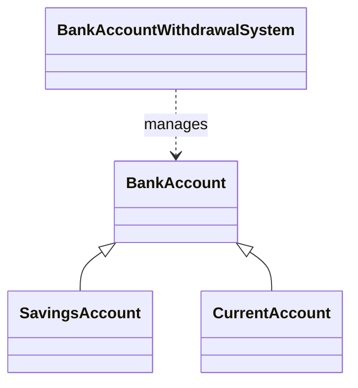
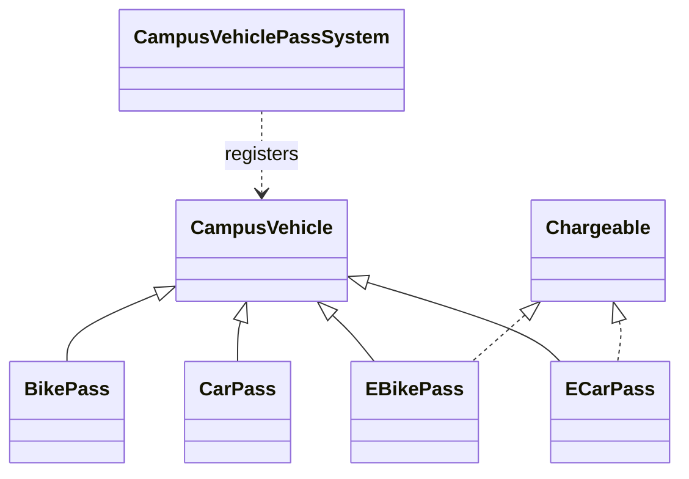
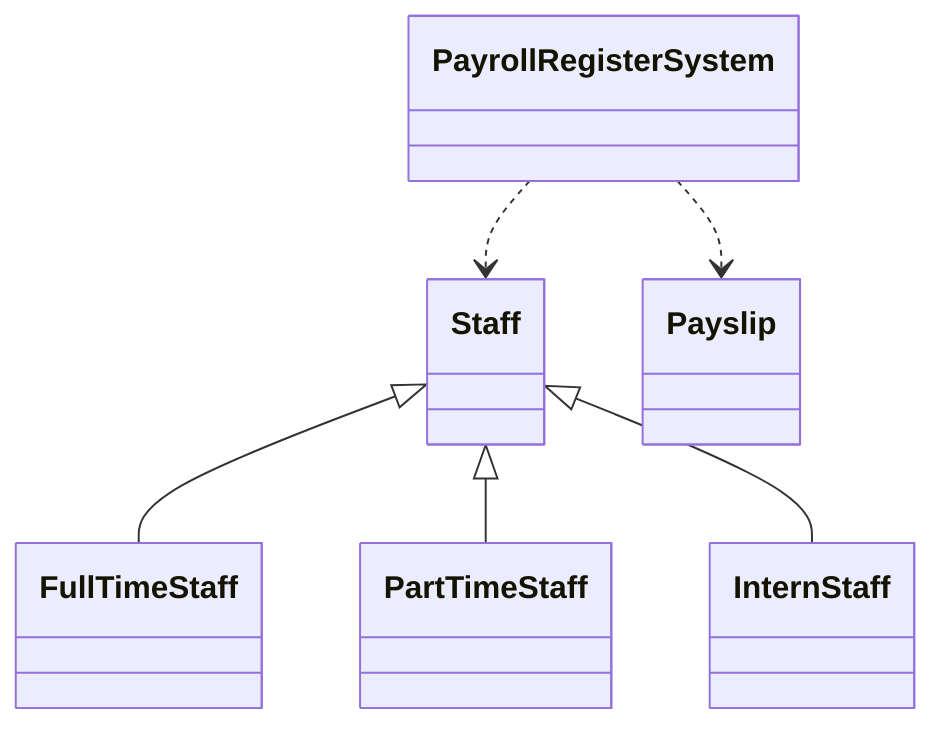

# Week 10 – S10 – Practice Problems
**Category B · Part A Coding Problems, Part B Quiz, Part C Concept Questions**

Branch: `feature/session_10`  
Folder: `src/main/java/week_10/class_problems/`  
Package: `week_10.class_problems`

## Part A — Coding Solutions

### 1. Bank Account Withdrawal System
Files: `BankAccount.java`, `SavingsAccount.java`, `CurrentAccount.java`, `BankAccountWithdrawalSystem.java`

- Savings withdrawals are accepted only if the resulting balance is at least 1000.
- Current account withdrawals are accepted only if the resulting balance is at least -5000.
- The common withdrawal workflow is in the abstract `BankAccount` class; subclasses supply their own rule.
- Demo reproduces the worksheet's sequence of four withdrawals.



### 2. Campus Vehicle Pass System
Files: `CampusVehicle.java`, `BikePass.java`, `CarPass.java`, `EBikePass.java`, `ECarPass.java`, `Chargeable.java`, `CampusVehiclePassSystem.java`

- Pass fees: Bike 300, Car 1000, E-Bike 300, E-Car 1000.
- Only electric vehicles implement `Chargeable` and can book charging bays.
- The system checks the interface instead of needing separate logic for every electric vehicle type.



### 3. Student Club Registration Management
Files: `ClubMember.java`, `StudentClubRegistrationManagement.java`

- Members are stored in a `HashSet`.
- `equals()` and `hashCode()` use **only the roll number**, so a new object with an existing roll number is rejected even when it is a different object instance.

### 4. Class Marks Grid Analysis
File: `ClassMarksGridAnalysis.java`

- Uses a 2D array to calculate each student's total.
- Computes each subject's average to two decimal places.
- Chooses the earliest student in a tie for top total.

### 5. Payroll Register System
Files: `Staff.java`, `FullTimeStaff.java`, `PartTimeStaff.java`, `InternStaff.java`, `Payslip.java`, `PayrollRegisterSystem.java`

- Full-time pay is fixed salary; part-time pay is hours × hourly rate; intern pay is fixed stipend.
- Stores payslips in a `Payslip[]` array.
- `Payslip.toString()` generates the readable text representation and the demo prints the total pay and top earner.



## Compile all Week 10 practice Java files (PowerShell)

Run from the repository root:

```powershell
javac -d out (Get-ChildItem -Path src\main\java\week_10\class_problems -Filter *.java -Recurse | ForEach-Object { $_.FullName })
```

## Run each demo

```powershell
java -cp out week_10.class_problems.BankAccountWithdrawalSystem
java -cp out week_10.class_problems.CampusVehiclePassSystem
java -cp out week_10.class_problems.StudentClubRegistrationManagement
java -cp out week_10.class_problems.ClassMarksGridAnalysis
java -cp out week_10.class_problems.PayrollRegisterSystem
```

## Part B — Quiz Answer Key

| Question | Answer | Reason |
|---|---|---|
| Q1 | **B** | A subclass can access a protected member and a public method, but not a private field directly. |
| Q2 | **C** | With single class inheritance, S cannot extend both Q and R. |
| Q3 | **B** | Constructors run from the base class first: Person → Employee → Manager. |
| Q4 | **C** | A subclass can directly access a protected field. |
| Q5 | **B** | Runtime overriding means the Bus implementation runs for a Bus object. |
| Q6 | **B** | Different parameter lists are overloading; redefining the same signature in a subclass is overriding. |
| Q7 | **A** | A base-type reference exposes base-declared members at compile time; Circle-only members need a cast. |
| Q8 | **C** | Dynamic dispatch calls Circle.area() and Square.area() for their corresponding objects. |
| Q9 | **B** | A Current object can be cast to Current, but not to unrelated Savings. |
| Q10 | **B** | Polymorphism lets each Plan object provide its own bill() implementation. |
| Q11 | **A** | printDocument() is the public essential behavior; the buffer and helper methods are hidden details. |
| Q12 | **B** | A Vehicle reference can refer to a Car object, but Vehicle itself is abstract. |
| Q13 | **B** | A concrete subclass must implement inherited abstract methods or itself be abstract. |
| Q14 | **B** | A concrete MonthlyReport cannot omit an abstract generateBody() implementation. |
| Q15 | **A** | An interface defines a contract; it does not hold per-object state or normally define each implementation. |
| Q16 | **B** | Interface abstract methods are implicitly public and abstract; fields are public static final. |
| Q17 | **C** | The class must implement both required interface operations, unless inherited valid implementations satisfy them. |
| Q18 | **C** | An interface is suited to a protocol shared by unrelated classes without per-object state. |
| Q19 | **B** | Dog IS-A Animal (generalization); Eagle CAN-DO Flyable (realization). |
| Q20 | **A** | equals(), hashCode(), and toString() are common root-object methods that classes often override. |

## Part C — Concept Question Guidance

### 1. Overloading vs overriding
**Overloading** uses the same method name with different parameter lists and is resolved at compile time. **Overriding** provides a subclass implementation with the same signature as an inherited method and is resolved at runtime through dynamic dispatch.

### 2. Constructor invocation order
When a derived object is created, the base-class constructor runs first, followed by the derived-class constructor. In Java, a subclass passes values to its base constructor with `super(arguments)`, which must appear first in the constructor body when used explicitly.

### 3. Concrete classes, abstract classes, and interfaces
A concrete class can be instantiated and provides implementations for all required methods. An abstract class cannot be instantiated directly; it can hold instance state, constructors, implemented methods, and abstract operations for subclasses. An interface defines a contract that different, even unrelated, classes can implement; it is a good choice for capabilities or common behavior without sharing a base-class identity.

### 4. Identical methods from two interfaces
If two interfaces declare the same compatible abstract method signature, one public implementation in the class can satisfy both contracts. This demonstrates that a class can implement multiple interfaces and reuse one implementation for a shared operation. If the declarations have incompatible return types, the class generally cannot satisfy both and must be redesigned.

### 5. Why override both equals() and hashCode()
If two objects are considered equal by `equals()`, they must return the same `hashCode()`. If only `equals()` is overridden, equal objects may have different hash codes; a `HashSet` or `HashMap` can then fail to detect duplicates or find a logically equal key reliably.

### 6. Shallow copy vs deep copy
A shallow copy duplicates the outer object but shares references to mutable nested objects. For example, two copies of a Student object may share the same mutable Address; changing the address through one copy unexpectedly affects the other. A deep copy duplicates the nested mutable objects too, so the copies can be changed independently.

### 7. Inner class vs static nested class
A non-static inner class is created through an enclosing object (for example, `outer.new Inner()`) and can access that outer object's instance members. A static nested class does not require an enclosing instance and can directly access only static members of the enclosing class. Use an inner class when an object belongs closely to one enclosing instance; use a static nested class for a helper type that is logically grouped inside another type but does not need its instance.

### 8. Array operation complexity
Accessing an array element by index is `O(1)), because the location can be calculated directly. Inserting or deleting in the middle is `O(n)) in the worst case because later elements must be shifted; a fixed-size array also needs free capacity for insertion.

### 9. Uniform processing of derived objects
An array of a base type can hold different subclass objects. Calling an overridden method through each base-type reference uses dynamic dispatch to choose the implementation belonging to the actual runtime object, so explicit type checks are unnecessary.

### 10. IS-A inheritance vs CAN-DO interfaces
Use inheritance for a genuine subtype relationship where the subclass is a kind of the base class and can be used in its place. Use an interface for a capability that different classes can support independently. For example, `Dog extends Animal` is an IS-A relationship, while `Bird implements Flyable` and `Drone implements Flyable` model the shared CAN-DO capability of flying.

**Source note:** The pasted worksheet ends during Concept Question 10 after “Provide an example scenario where an interface”; the example above addresses the portion that is visible.
