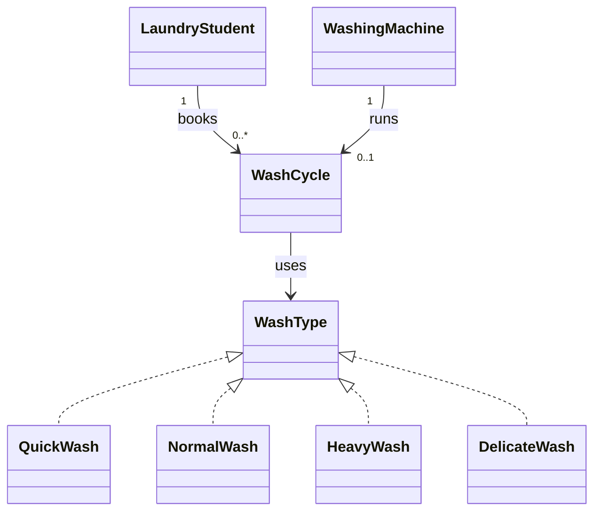
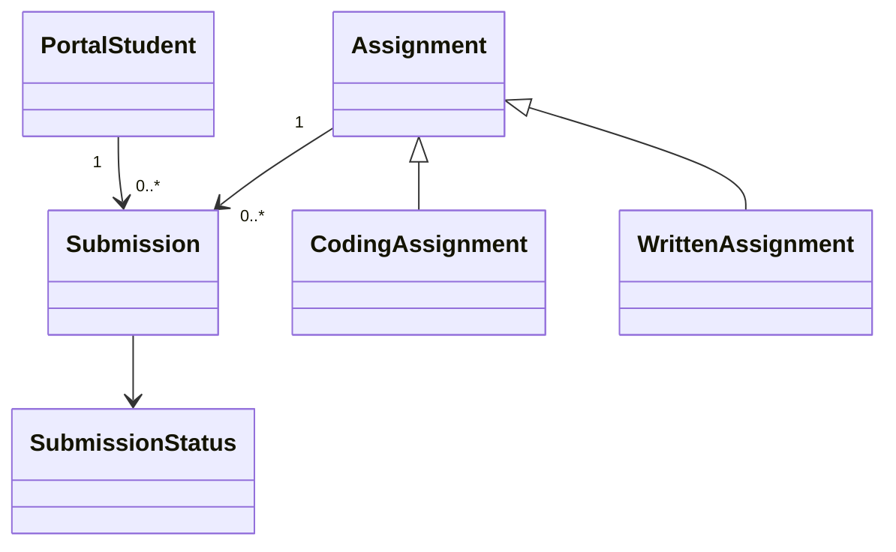
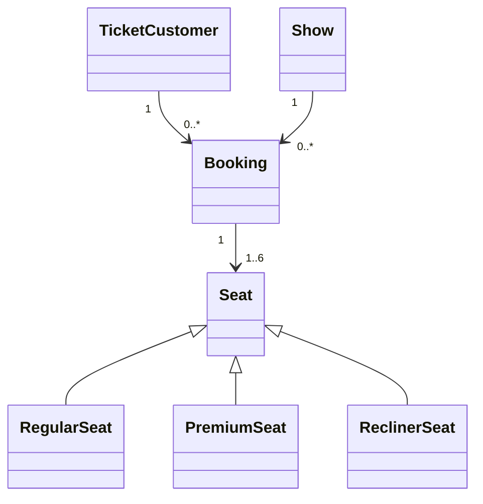
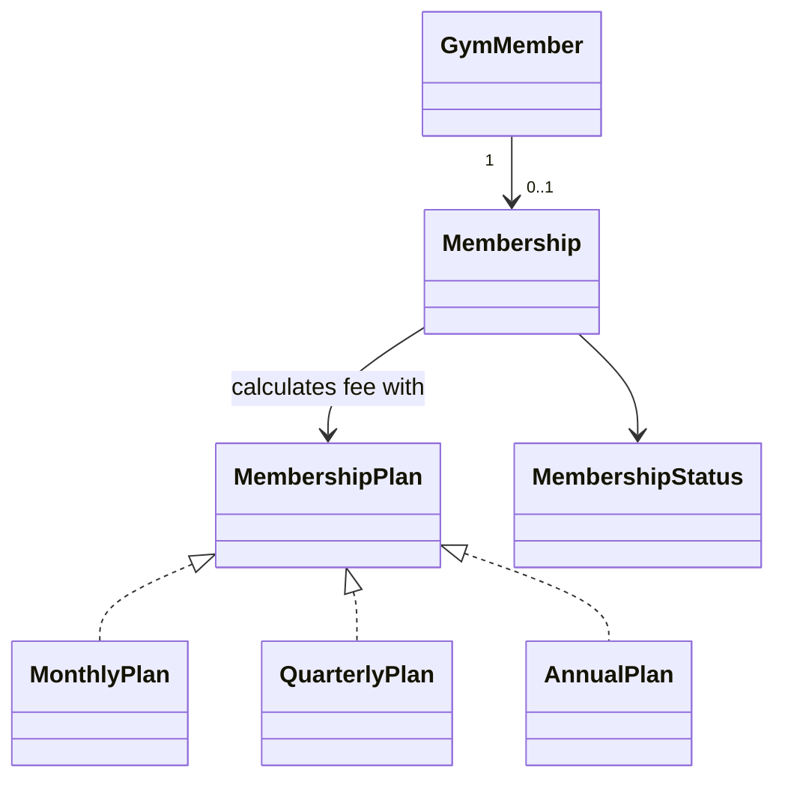
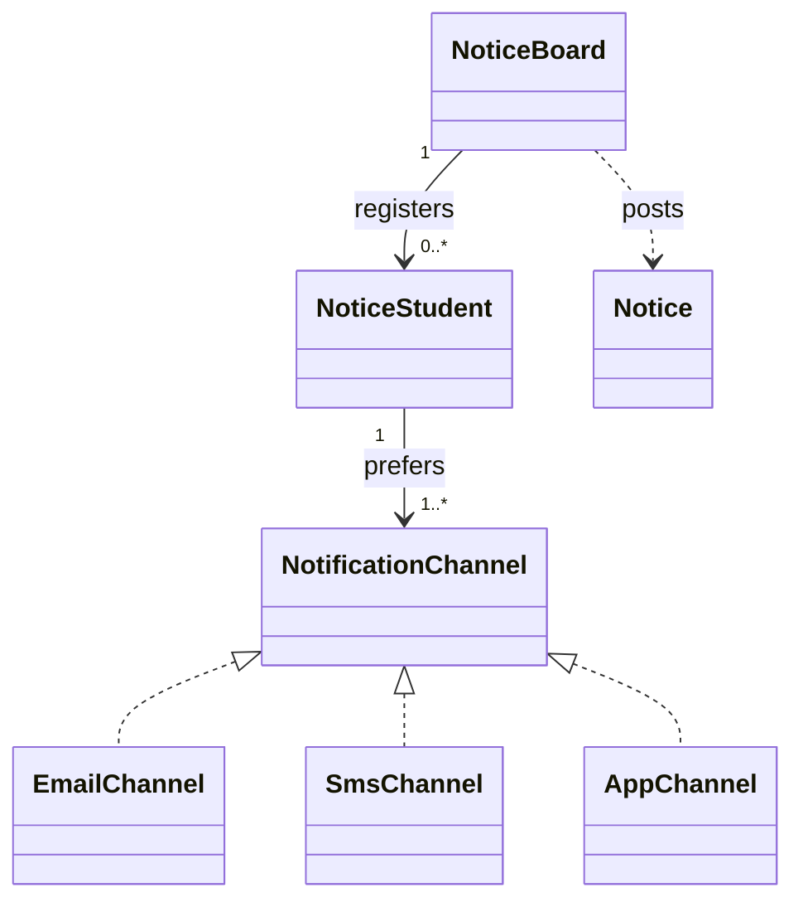

# Week 8 – Object Modeling Assignment Problems

Branch: `feature/session_8`

Java source files are in this folder and use package `week_8.assignment_problems`.

## Problem 1 – Hostel Laundry Queue

**Classes and relationships**
- A `LaundryStudent` can participate in many wash cycles over time.
- A `WashingMachine` has zero or one active `WashCycle` at a time.
- Each `WashCycle` tracks one student, one machine, and one `WashType`.
- `QuickWash`, `NormalWash`, `HeavyWash`, and `DelicateWash` implement `WashType`; adding a wash type does not change `WashingMachine.startWash()`.



Run: `java -cp out week_8.assignment_problems.HostelLaundryQueue`

## Problem 2 – Assignment Submission Portal

**Classes and relationships**
- A `PortalStudent` can have multiple submissions.
- Each `Submission` refers to one `PortalStudent` and one `Assignment`.
- `CodingAssignment` and `WrittenAssignment` specialize `Assignment` and apply different late penalties.
- Submission status is private and changes only through `submit()` and `grade()`.



Run: `java -cp out week_8.assignment_problems.AssignmentSubmissionPortal`

## Problem 3 – Campus Premiere Ticket Counter

**Classes and relationships**
- One `Show` owns the seat catalogue and keeps track of reservations for that show.
- One `Booking` belongs to one `TicketCustomer` and one `Show`, and contains 1–6 seats.
- `RegularSeat`, `PremiumSeat`, and `ReclinerSeat` define their own price through `Seat.getPrice()`.
- Cancelling a booking before the show starts releases all its seats.



Run: `java -cp out week_8.assignment_problems.CampusPremiereTicketCounter`

## Problem 4 – FitZone Membership Desk

**Classes and relationships**
- A `GymMember` buys a `Membership`.
- Each membership uses a `MembershipPlan` for its fee calculation.
- Monthly, quarterly, and annual plans implement the common plan interface.
- `Membership` controls its own Active/Frozen/Expired state.



Run: `java -cp out week_8.assignment_problems.FitZoneMembershipDesk`

## Problem 5 – Campus Notice Broadcaster

**Classes and relationships**
- A `NoticeBoard` registers many `NoticeStudent` records and posts validated `Notice` objects.
- Each notice targets one or more departments; matching students receive it on every preferred channel.
- `EmailChannel`, `SmsChannel`, and `AppChannel` implement `NotificationChannel`. A new channel can be added without changing `NoticeBoard`.



Run: `java -cp out week_8.assignment_problems.CampusNoticeBroadcaster`

## Compile all Week 8 Java files (PowerShell)

Run this from the repository root:

```powershell
javac -d out (Get-ChildItem -Path src\main\java\week_8\assignment_problems -Filter *.java -Recurse | ForEach-Object { $_.FullName })
```

Then run each demo class using the commands listed under its problem.
