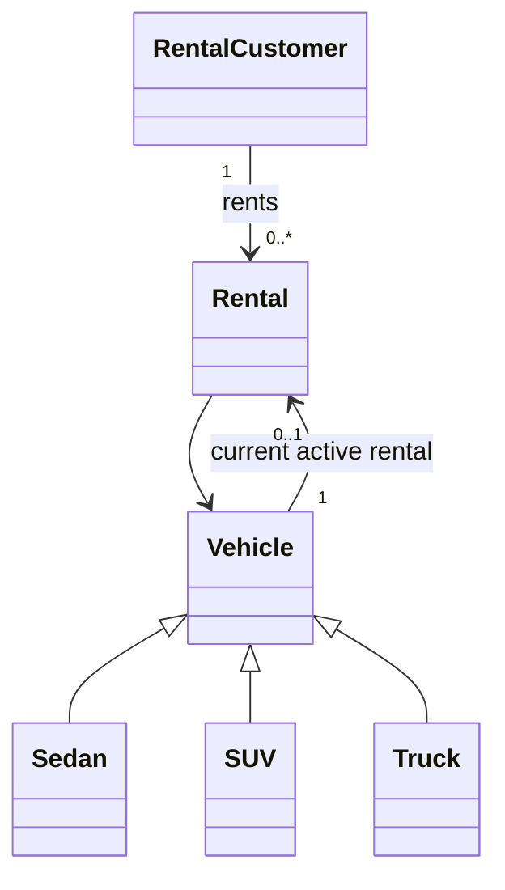
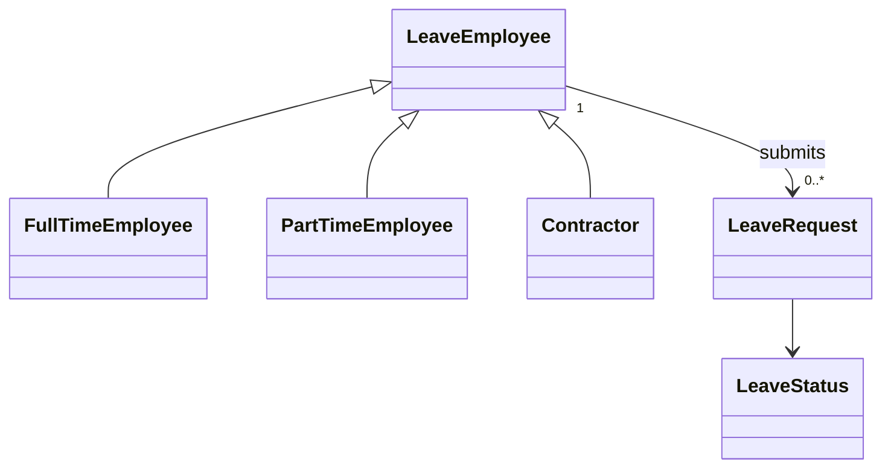
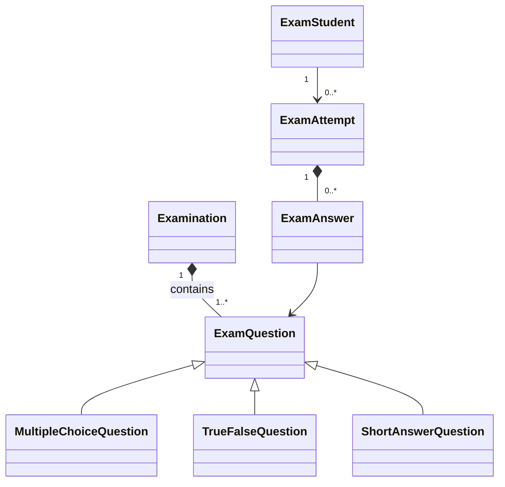
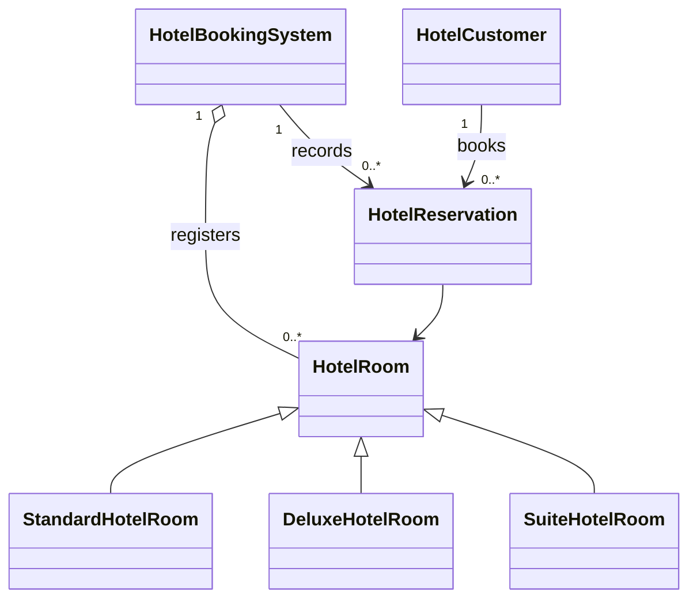
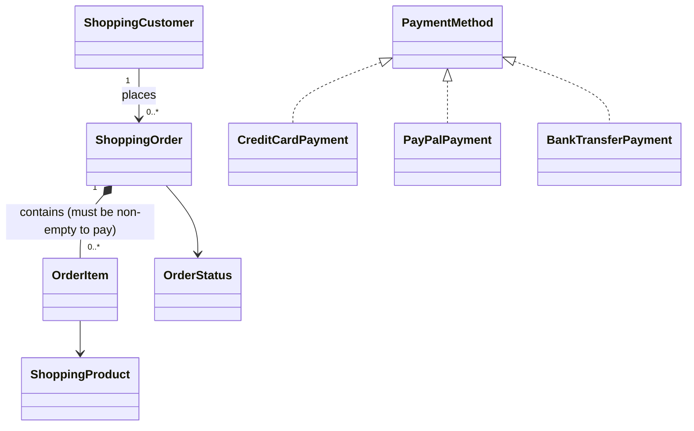

# Week 8 – Practice Problems
**Topic:** Object Class Methods, Inner Classes & UML Diagrams  
**Branch:** `feature/session_8`  
**Package:** `week_8.class_problems`

The five coding questions are implemented as separate Java systems. The prices and a few sample policy values that were not specified in the worksheet are illustrative assumptions, noted below.

## 1. Vehicle Rental System

Run: `java -cp out week_8.class_problems.VehicleRentalSystem`

- `Vehicle` is an abstract class; `Sedan`, `SUV`, and `Truck` override charge calculation.
- A `Rental` relates one `RentalCustomer` to one `Vehicle` for a number of days.
- Vehicle availability is controlled by a private active-rental reference. Returning the active rental frees the vehicle.
- **Illustrative rates** (the worksheet doesn't specify rates): Sedan $50/day, SUV $80/day, Truck $120/day.



## 2. Employee Leave Request Workflow

Run: `java -cp out week_8.class_problems.LeaveRequestWorkflow`

- `LeaveEmployee` is the base class for `FullTimeEmployee`, `PartTimeEmployee`, and `Contractor`.
- A `LeaveRequest` has one employee, a start/end date, and a private state.
- Only a pending request can be reviewed. Approved and rejected requests cannot return to pending.
- **Illustrative policy limits** (the worksheet doesn't specify maximums): full-time 20 consecutive calendar days, part-time 10, contractor 5.



## 3. Online Examination System

Run: `java -cp out week_8.class_problems.OnlineExaminationSystem`

- `Examination` contains one or more `ExamQuestion` objects.
- `MultipleChoiceQuestion`, `TrueFalseQuestion`, and `ShortAnswerQuestion` implement their own evaluation by overriding `isCorrect()`.
- An `ExamAttempt` stores the `ExamAnswer` objects and prevents answer edits after submission.
- An `ExamStudent` stores an attempt by exam ID, preventing a second attempt after submission.



## 4. Hotel Booking System

Run: `java -cp out week_8.class_problems.HotelBookingSystemDemo`

- `HotelBookingSystem` owns the registered rooms and records reservations.
- `StandardHotelRoom`, `DeluxeHotelRoom`, and `SuiteHotelRoom` override the nightly price calculation.
- Active reservations are checked for date overlap before a new reservation can be confirmed. Checkout date is treated as exclusive.
- A reservation can be cancelled only before its deadline, which is set to midnight one day before check-in.
- **Illustrative nightly prices** (not specified in the worksheet): Standard $100, Deluxe $180, Suite $300.



## 5. Payment Processing for a Shopping System

Run: `java -cp out week_8.class_problems.PaymentProcessingSystem`

- `ShoppingCustomer` creates `ShoppingOrder` objects; each order contains `OrderItem` objects, which refer to products and quantities.
- `CreditCardPayment`, `PayPalPayment`, and `BankTransferPayment` implement `PaymentMethod`.
- The order status changes from Pending to Paid only when `processPayment()` returns success. Empty orders are rejected. The PayPal demo is configured to fail deliberately.



## Compile all Week 8 practice Java files

Run from the repository root in PowerShell:

```powershell
javac -d out (Get-ChildItem -Path src\main\java\week_8\class_problems -Filter *.java -Recurse | ForEach-Object { $_.FullName })
```

Then run each demo class with the command above.

## Quiz answer key

| Question | Answer | Reason |
|---|---|---|
| 1 | C — Polymorphism | A common processor handles different event types through a shared type. |
| 2 | C — Encapsulation | Private state is changed through a validating method. |
| 3 | C — Author 1 to Book 1..* | Each book has one author; an author can write one or more books, as phrased in the question. |
| 4 | D — Composition | Cart items depend on their cart for their lifecycle. |
| 5 | D — Generalization | ProgrammingCourse is an “is-a” Course. |
| 6 | C — Realization | A concrete class implements the Printable interface contract. |
| 7 | B — Association | Customer and Order are linked without strong lifecycle ownership. |
| 8 | C — State diagram | It models lifecycle states and valid transitions. |
| 9 | B — Abstraction | The service uses a generic interface rather than concrete report details. |
| 10 | C — Sequence diagram | It shows time-ordered messages between objects. |

## Concept question guidance

### 1. Encapsulation in User email
Keep the email field private and update it only through `changeEmail()`. That method validates format and uniqueness before changing the object. This prevents other code from putting the user into an invalid state and keeps the validation rule in one place.

### 2. Inheritance vs composition for reporting capabilities
Inheritance can represent a genuine “is-a” relationship when subclasses share stable behavior. Optional capabilities such as exporting and charting fit composition better: a report can be equipped with the capabilities it needs. This avoids many rigid subclasses for every combination and makes new capabilities easier to add.

### 3. Notification abstraction and polymorphism
Define a `Notification` interface with a send operation. Email, SMS, Push, and future In-App implementations override that operation. The service calls the interface method on each object; runtime polymorphism selects the implementation without a conditional branch for every channel.

### 4. Composition and aggregation
Organization–Department is composition because the scenario says departments are dissolved when the organization ceases to exist. Department–Employee is aggregation because employees may outlive the department and be reassigned elsewhere.

### 5. Student–Course multiplicity and duplicate enrollment
The relationship is many-to-many: a student can take multiple courses and a course can have many students. UML multiplicity expresses the permitted number of related objects; it does not by itself enforce uniqueness of a specific student-course pair. A separate business constraint, such as a unique composite key or a set keyed by student ID and course ID, must prevent duplicate enrollments.

**Source note:** The uploaded practice sheet ends mid-sentence in Concept Question 5 after “enforced by other…”. The explanation above answers the complete rule that is visible before the cutoff.
